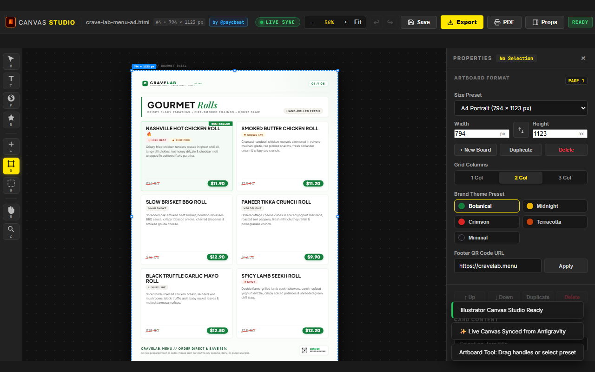
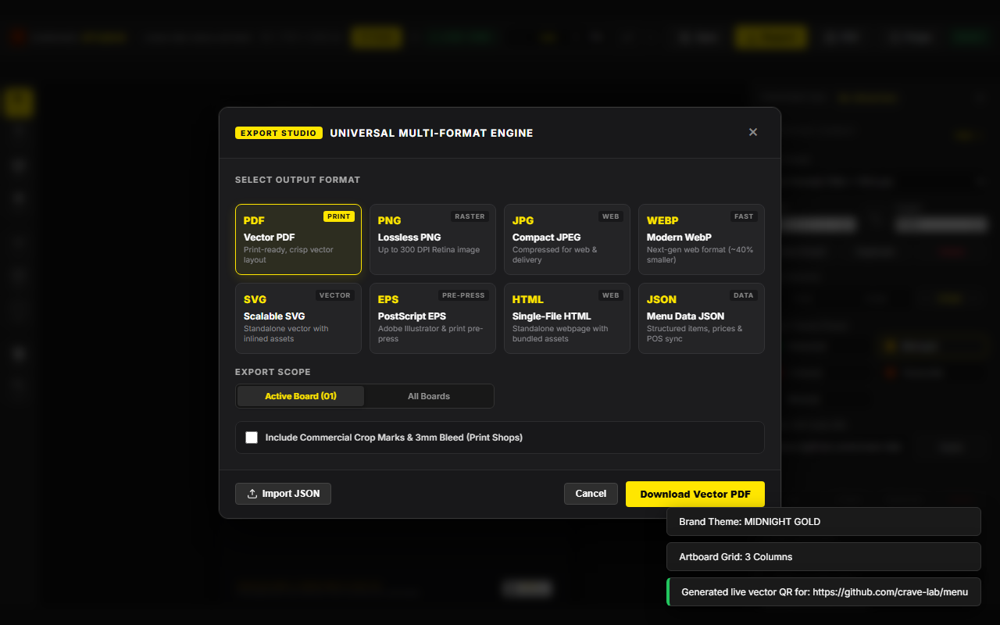
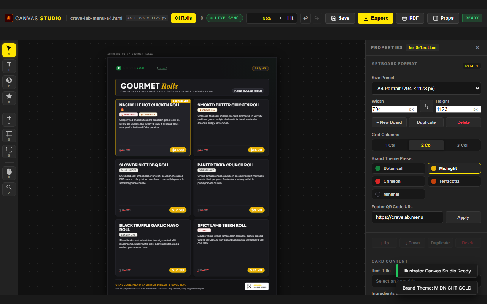
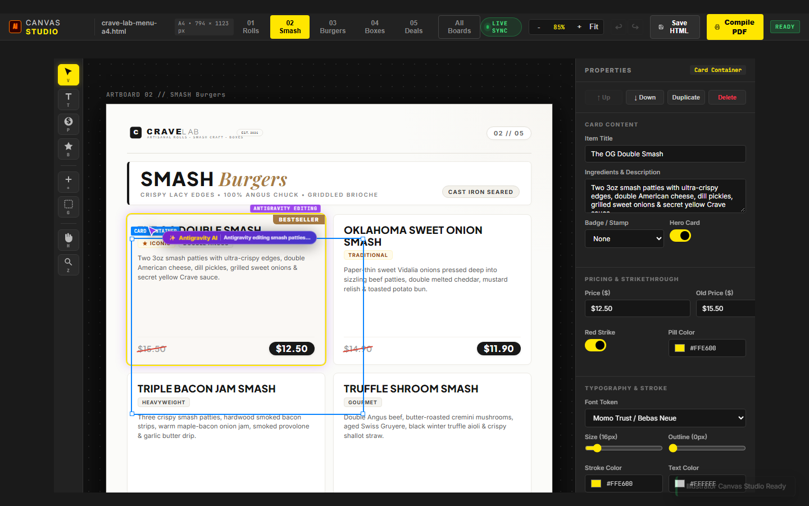
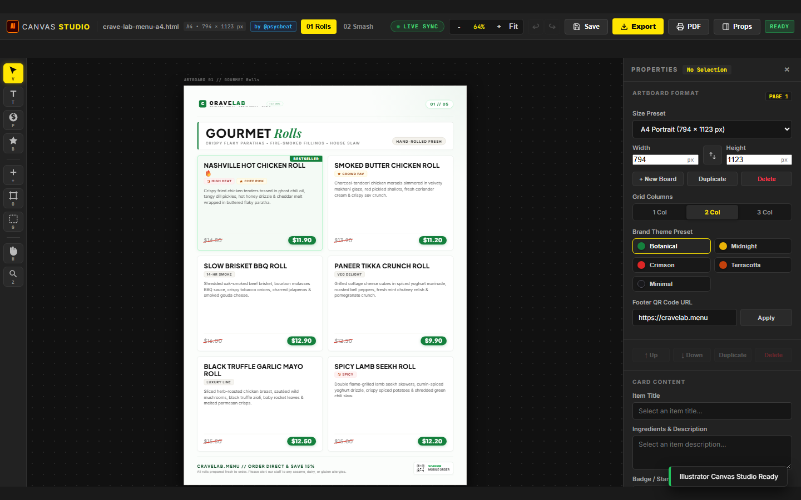
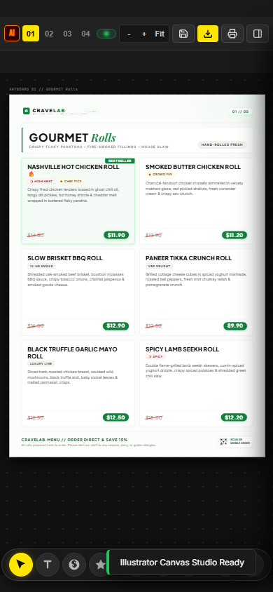
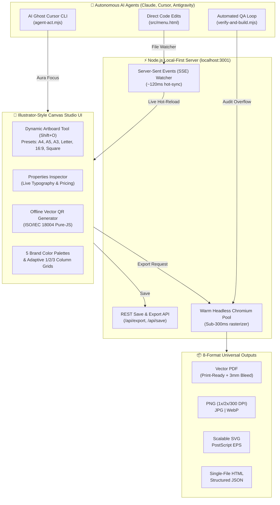

# 🎨 PsycBeat's Canvas Studio for AI & Agents
### An Adobe Illustrator-Inspired Multi-Artboard Design Workbench & Vector Pipeline for AI Agents and Human Creators

> **A 100% free, local-first alternative to Claude Canvas, ChatGPT Canvas, Canva, and Figma.**
> Styled with **MotionSites-grade nocturnal glassmorphism**, equipped with an interactive **Welcome Tutorial & Artboard Size Selector**, direct element dragging, Illustrator vector shapes (`M`, `L`, `\`, `T`), Illustrator-grade artboards (`Shift + O`), an 8-format universal export engine (Vector PDF, 300 DPI PNG, EPS, SVG, WebP, JPG, HTML, JSON), commercial pre-press crop marks & 3mm bleed, real-time SSE live sync, and an automated zero-overflow visual verification loop.
>
> **Created & Architected by [@psycbeat](https://github.com/psycbeat)**

[](#-why-canvas-studio-beats-closed-ai-canvases)
[](#-adobe-illustrator-for-ai-agents)
[](#-motionsites-inspired-uxui)
[](#-license)
[](https://nodejs.org/)
[](https://playwright.dev/)
[](#-print-engineering--verification)
[](LICENSE)

<br/>

<div align="center">
  <a href="https://psycbeat.github.io/canvas-menu-pipeline/">
    
  </a>
</div>

---

## 📸 Visual Showcase

<div align="center">

### 🎨 Illustrator-Style Artboard Tool (`Shift + O`)
*Interactive 8-point drag-to-resize handles, live dimension pills, and instant presets (A4, A5, A3, Letter, 16:9, Square 1080p)*



<br/><br/>

### 💾 Universal 8-Format Export Studio (`Ctrl + E`)
*Fast downloads via warm headless Chromium: Vector PDF, 300 DPI PNG, EPS, SVG, WebP, JPG, HTML, and JSON with 3mm commercial bleed + trim crop marks*



<br/><br/>

### 🌙 1-Click Culinary Brand Themes (e.g. Midnight Gold)
*Full-menu rebranding across 5 print-calibrated color palettes in a single click*



<br/><br/>

### 🤖 Live AI Ghost Cursor & Collaborative Focus
*Floating `✨ Antigravity AI` cursor badge and pulsating focus aura showing where an autonomous AI agent is editing in real time*



<br/><br/>

### 📱 Adaptive Split-Screen & Mobile Responsiveness
*Stage sizer engine preventing negative coordinate clipping, off-canvas properties drawer, and auto-converting floating tool dock*

<p align="center">
  
  &nbsp;&nbsp;
  
</p>

</div>

---

## 💡 What is Canvas Studio?

**Canvas Studio** bridges the gap between **autonomous AI coding agents** (Claude Code, Cursor, Codex, Gemini, Antigravity, ChatGPT) and **professional graphic design & pre-press vector software** (Adobe Illustrator, InDesign).

While modern Large Language Models excel at writing code, they have been handicapped by closed, proprietary canvas widgets (like Claude Canvas and ChatGPT Canvas) that trap designs inside ephemeral chat windows, lack professional print specifications, and offer limited, lossy export capabilities.

**Canvas Studio changes that.** It provides a persistent, local-first, multi-artboard design canvas that lives inside your Git repository. It lets AI agents and humans pair-program visually in real time: the agent edits code or dispatches attention markers via CLI/SSE, the canvas reflects changes in sub-120 milliseconds without a browser refresh, and a headless Chromium verification engine audits the layout against commercial print constraints with zero CSS overflow.

---

## 🏆 Why Canvas Studio Beats Closed AI Canvases

| Feature | Claude Canvas / Artifacts | ChatGPT Canvas | Canva | Adobe Illustrator | **CRAVE LAB // Canvas Studio** |
| :--- | :---: | :---: | :---: | :---: | :---: |
| **Open-Source & Local-First** | ❌ Proprietary Cloud | ❌ Proprietary Cloud | ❌ Proprietary Cloud | ❌ Desktop Closed | ✅ **100% Open-Source & Git-Native** |
| **Pricing & Subscription** | ❌ \$20/month | ❌ \$20/month | ❌ \$15/month | ❌ \$35–\$60/month | ✅ **100% Free Forever (MIT)** |
| **Multi-Artboard Workbench** | ❌ Single Artifact | ❌ Single Document | ⚠️ Multi-page Slide | ✅ Full Artboards | ✅ **True Multi-Artboard Canvas** |
| **Illustrator Artboard Tool (`Shift+O`)** | ❌ None | ❌ None | ⚠️ Locked Layouts | ✅ Native | ✅ **8 Drag Handles + 9 Instant Presets** |
| **Agentic AI Live Pairing** | ⚠️ Full Rewrite | ⚠️ Full Rewrite | ❌ No AI Agent API | ❌ No Agent API | ✅ **Sub-120ms SSE Sync + Ghost Cursor** |
| **Pre-Press Bleed (3mm) & Crop Marks** | ❌ None | ❌ None | ⚠️ Paid Feature | ✅ Native | ✅ **Built-in Commercial Pre-Press** |
| **High-Res Rasterization (300 DPI)** | ❌ 72–96 DPI | ❌ 72–96 DPI | ⚠️ Premium Only | ✅ Native | ✅ **1x, 2x Retina & 3x 300 DPI** |
| **Universal 8-Format Export** | ❌ Code/Copy | ❌ Code/Copy | ⚠️ Limited Formats | ✅ Plugin Needed | ✅ **PDF, PNG, JPG, WebP, SVG, EPS, HTML, JSON** |
| **Headless Automated Verification** | ❌ None | ❌ None | ❌ None | ❌ None | ✅ **Playwright Zero-Overflow CI Loop** |
| **Zero External Dependencies** | ❌ Cloud-bound | ❌ Cloud-bound | ❌ Cloud-bound | ❌ 10 GB+ Install | ✅ **Zero Frontend Bundler / Vanilla ESM** |

---

## 📐 System Architecture



---

## 🌟 Core Superpowers

### 1. 🎨 Adobe Illustrator-Inspired Artboard Engine (`Shift + O`)
* **Multi-Artboard Freeform Canvas**: Pan (`H`), zoom (`Z` or `Ctrl + Wheel` from 25% to 200%), and organize dozens of boards side-by-side.
* **8-Point Interactive Handles**: Drag any corner or side handle to resize artboards on the fly, complete with real-time dimension badges (`794 × 1123 px`).
* **9 Instant Standard Presets**:
  * **A4 Portrait** ($794 \times 1123\text{ px}$)
  * **A4 Landscape** ($1123 \times 794\text{ px}$)
  * **A5 Portrait / Flyer** ($559 \times 794\text{ px}$)
  * **A3 Poster** ($1123 \times 1587\text{ px}$)
  * **US Letter** ($816 \times 1056\text{ px}$)
  * **US Letter Landscape** ($1056 \times 816\text{ px}$)
  * **Digital TV 16:9** ($1920 \times 1080\text{ px}$)
  * **Instagram / Square 1080p** ($1080 \times 1080\text{ px}$)
  * **Custom Dimensions** (Dynamic interactive drag)
* **One-Click Actions**: Instant Orientation Swap (Portrait $\leftrightarrow$ Landscape), Duplicate Board, and Delete Board.

### 2. 💾 Universal 8-Format Export Studio (`Ctrl + E`)
Exports happen in sub-second timeframes powered by a warm headless Chromium singleton worker pool:
1. **Vector PDF**: Crisp vector typography and embedded vector graphics, with optional pre-press bleed and trim marks.
2. **Lossless PNG**: Multi-DPI resolution scaling ($1\times$ 96 DPI, $2\times$ Retina 192 DPI, and $3\times$ 300 DPI commercial print).
3. **Compact JPEG**: High-speed compression for web delivery and online menus.
4. **Modern WebP**: Next-gen web optimization ($\approx 40\%$ smaller than PNG).
5. **Scalable SVG**: Vector graphic with inlined styling and assets.
6. **PostScript EPS**: `%!PS-Adobe-3.0 EPSF-3.0` compliant vector file ready for Adobe Illustrator, CorelDRAW, and commercial offset printers.
7. **Single-File HTML**: Standalone webpage bundling all vector graphics and brand logos as base64 data URIs.
8. **Structured JSON**: Export and import complete menu and layout schemas for seamless POS and CMS synchronizations.

### 3. 🖨️ Commercial Pre-Press Mode
* Injects **3mm ($24\text{ px}$)** bleed margins outside the document boundary.
* Draws calibrated **$0.5\text{ pt}$ hairline corner trim crop marks** for commercial Guillotine paper cutters.
* Eliminates white borders and edge clipping during professional printing.

### 4. ⚡ Sub-120ms Real-Time Live Sync & AI Ghost Cursor
* **Zero-Refresh Hot Reload**: Built on Server-Sent Events (SSE) and native Node filesystem watching (`fs.watch`). When an AI assistant edits `src/menu.html` or CSS tokens, the open canvas updates instantly in $\approx 120\text{ ms}$ without resetting your scroll or selection state.
* **AI Ghost Cursor (`agent-act.mjs`)**: Autonomous agents can highlight items on the user's screen using a visual cursor badge (`✨ Antigravity AI`) and a pulsating focus aura to communicate what is being edited.

### 5. 🎭 1-Click Culinary Brand Themes & Adaptive Grids
* Rebrand entire documents across 5 print-calibrated color palettes:
  * 🌿 **Botanical Forest** (Default — Deep Emerald & Crisp Off-White)
  * 🌙 **Midnight Gold** (Dark Luxury Steakhouse & Cocktail Bar)
  * 🍔 **Bistro Crimson** (Smash Burger Joint & Retro Diner)
  * 🍕 **Artisanal Terracotta** (Wood-Fired Pizzeria & Rustic Bakery)
  * ☕ **Minimal Monochrome** (Nordic Specialty Roaster & Japanese Minimal)
* **Adaptive Grid Columns**: Toggle between `1 Col` (ideal for A5 flyers), `2 Col` (standard A4 menus), and `3 Col` (horizontal displays and posters).

### 6. 📱 Zero-Dependency Pure-JS Vector QR Generator
* Built-in pure JavaScript implementation of ISO/IEC 18004.
* Generates lightweight, scannable `<svg>` QR codes directly in the browser or terminal with zero npm dependencies or external API calls.

---

## 🤖 For AI Agents & LLMs (`llms.txt`)

If you are an AI assistant (Claude Code, Cursor, Codex, Gemini CLI, ChatGPT Actions), you can control and verify Canvas Studio programmatically:

* **Machine-Readable Spec**: See [`llms.txt`](llms.txt) for direct API specs and CLI contracts.
* **Live SSE Endpoint**: `GET http://localhost:3001/events`
* **Programmatic Save**: `POST http://localhost:3001/api/save` with `{ "html": "..." }`
* **Programmatic Export**: `POST http://localhost:3001/api/export` with `{ "format": "pdf|png|eps|svg", ... }`
* **Dispatch Ghost Cursor**:
  ```bash
  node scripts/agent-act.mjs <board-id> <card-index> "<Message>"
  ```
* **Verify Zero CSS Overflow**:
  ```bash
  npm run verify
  ```

---

## 🚀 Quickstart

### Prerequisites
* [Node.js](https://nodejs.org/) (v18 or higher recommended)
* [Playwright](https://playwright.dev/)

### 1. Clone & Install

```bash
# Clone the repository
git clone https://github.com/psycbeat/canvas-menu-pipeline.git
cd canvas-menu-pipeline

# Install dependencies
npm install

# Install Playwright browser binaries (one-time setup)
npx playwright install chromium
```

### 2. Launch the Visual Canvas Studio

```bash
npm start
# or
npm run editor
```

Navigate to **[http://localhost:3001](http://localhost:3001)** in any modern browser.

---

## ⌨️ Studio Keyboard Shortcuts

| Shortcut | Tool / Action | Description |
| :--- | :--- | :--- |
| `Ctrl + E` | **Export Studio** | Open the 8-Format Universal Export Modal with pre-press options |
| `V` | **Selection Tool** | Select cards, titles, descriptions, and price pills |
| `T` | **Type / Text Tool** | Double-click any text for inline `contenteditable` typing |
| `P` | **Price Tool** | Edit price pills, currency toggles, and strikethroughs |
| `B` | **Badge Stamper** | Stamp dietary chips (`BESTSELLER`, `HIGH HEAT 🌶️`, `CHEF PICK ⭐`) |
| `+` | **Add Card** | Insert a new menu item card into the active artboard |
| `O` or `Shift + O` | **Artboard Tool** | Enter Illustrator Artboard mode with 8 drag handles & presets |
| `Shift + N` | **New Artboard** | Instantly insert a new artboard into the canvas |
| `G` | **Print Safe Guides** | Toggle print-safe margin boundary overlay |
| `H` | **Hand Tool** | Click and drag to pan across the canvas |
| `Z` | **Zoom Tool** | Click to zoom in / `Ctrl + Wheel` to zoom dynamically |
| `I` | **Toggle Inspector** | Open / collapse the Properties Panel or off-canvas drawer |
| `Ctrl + Z` | **Undo** | Step backward in the document history stack |
| `Ctrl + Y` | **Redo** | Step forward in the document history stack |
| `Ctrl + S` | **Save HTML** | Persist DOM changes back to `src/menu.html` |
| `Delete` / `Backspace` | **Delete Card** | Remove the currently selected card |
| `Escape` | **Deselect / Close** | Close modals, inspector drawer, and clear selection |

---

## 🖨️ Headless Print Engineering & Verification Loop

Canvas Studio includes a fully automated verification engine built on Playwright:

```bash
# Run visual verification and compile production vector PDF
npm run build:pdf
```

### Verification Pipeline Guarantees:
1. Loads [`src/menu.html`](src/menu.html) in headless Chromium with high-DPI ($2\times$ Retina) scale factor.
2. Dynamically extracts `--page-width` and `--page-height` from the document root.
3. Audits every artboard for overflow: asserts `scrollHeight <= clientHeight` and `scrollWidth <= clientWidth`.
4. Saves pixel-perfect $2\times$ Retina preview images to `output/page-*.png`.
5. Compiles [`output/crave-lab-menu-a4-production.pdf`](output/crave-lab-menu-a4-production.pdf) with embedded vector typography, precise print margins, and zero clipping.

---

## 🧪 Automated Test Suite

Run the automated test suites:

```bash
# Run all tests (Responsive + Artboard + 8 Export Formats)
npm test

# Run individual suites:
npm run test:responsive   # Audits 5 viewport sizes (Mobile, Tablet, Split, Desktop, Ultrawide)
npm run test:artboard     # Tests resize handles, presets, orientation swap, duplicate, delete
npm run test:exports      # Tests PDF, PNG 1x/2x/3x, JPG, WebP, SVG, EPS, HTML, and JSON exports
```

---

## 📁 Repository Structure

```
canvas-menu-pipeline/
├── .github/                      # CI/CD Workflows
│   └── workflows/ci.yml          # Automated test & PDF build pipeline
├── assets/                       # Vector assets (brand logo, QR code, stamps)
│   ├── brand-logo.svg
│   ├── flame.svg
│   ├── lightning.svg
│   ├── qr-code.svg
│   └── star.svg
├── editor/                       # Canvas Design Studio frontend (Zero-build ESM)
│   ├── index.html                # Studio workbench & Export Studio modal
│   ├── editor.css                # Dark theme, modal styles, responsive rules
│   ├── editor.js                 # Interactive engine, presets, drag-resize, export
│   └── qr-svg.js                 # Zero-dependency ISO/IEC 18004 pure-JS QR generator
├── output/                       # Compiled production PDFs, images, and test artifacts
│   └── crave-lab-menu-a4-production.pdf
├── scripts/                      # Local servers and automated pipelines
│   ├── editor-server.mjs         # Node HTTP + SSE live sync & /api/export server
│   ├── export-engine.mjs         # Warm Chromium pool & 8-format export serializers
│   ├── agent-act.mjs             # CLI tool to dispatch AI ghost cursor moves
│   ├── verify-and-build.mjs      # Playwright zero-overflow QA & PDF builder
│   ├── test-responsive.mjs       # Multi-viewport responsive test suite
│   ├── test-artboard-tool.mjs    # Artboard tool & resize automation tests
│   └── test-exports.mjs          # 8-format export & UI test suite
├── src/                          # Master print template
│   └── menu.html                 # 5-page modular menu with 5 brand themes
├── llms.txt                      # Machine-readable spec for AI agents & LLMs
├── LICENSE                       # MIT License
├── package.json                  # Package scripts & dependencies (v2.0.0)
└── README.md                     # Project documentation & marketing guide
```

---

## 👤 Author & Credits

**psycbeat**
* GitHub: [@psycbeat](https://github.com/psycbeat)
* Repository: [canvas-menu-pipeline](https://github.com/psycbeat/canvas-menu-pipeline)

---

## 📄 License

This project is open-source under the [MIT License](LICENSE).
